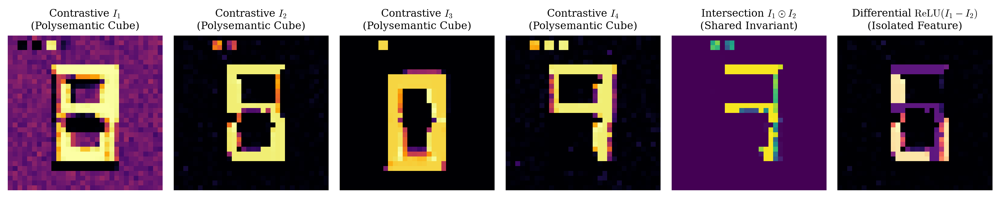
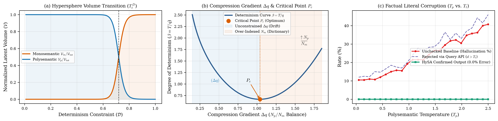

# HySA (Hybrid Semantic Architecture): Preserving Polysemantic Abstraction via Contrastive Inference Tensors, Monosemantic Indexing, and Topological Temperature ($T_t$)

[](https://doi.org/10.5281/zenodo.23456159)
[](https://opensource.org/licenses/MIT)
[](https://www.python.org/downloads/)
[](https://pytorch.org/)

> *"The AI industry views polysemanticity as a curse... yet perhaps it is the very blessing that made intelligence possible."*

Official repository for the paper:  
**"HySA (Hybrid Semantic Architecture): Preserving Polysemantic Abstraction via Contrastive Inference Tensors, Monosemantic Indexing, and Topological Temperature ($T_t$)"**  
*Author: Francesco Mariani (Independent Systems Architect)*

---

## ⚡ Overview & Motivation

Contemporary *Mechanistic Interpretability* research treats neuronal polysemanticity as a compression artifact to be eliminated via Sparse Autoencoders (SAEs). **HySA** proposes the opposite: **connections and polysemantic overlap are what generate intelligence.**

A purely monosemantic neuron has zero associative connections ($\emptyset$ intelligence): like an entry in a static dictionary, it is cognitively "stupid," yet it is **strictly rigorous**—making it essential for factual memory and hallucination prevention.

| Neuronal Regime | Role in HySA | Examples | Structural Property |
| :--- | :--- | :--- | :--- |
| **Polysemantic Network ($N_p$)** | **Intelligence & Abstraction** | `IP`, `DNS`, `White Pages`, `Phone Number` | High relational connectivity; compresses multiple concepts into unified structural meanings. |
| **Monosemantic Registry ($N_m$)** | **Memory & Verification** | `8.8.8.8`, `24`, `JOHN`, `Port 53` | Zero associative intelligence ($\emptyset$); orthogonal, rigorous literals that prevent hallucinations. |

Rather than coupling $N_p$ and $N_m$ in **series** (which creates a non-abstractive bottleneck) or in **parallel** (which is computationally inefficient), **HySA** integrates them into a unified architecture delimited by neuronal semanticity and queried via a deterministic internal API.

---

## 🧭 Terminology Clarification (Systems Heuristics vs. Formal Math)

We use operating system metaphors to describe exact geometric operations in latent space $\mathcal{S} \subset \mathbb{R}^D$:

| Systems Heuristic | Formal Mathematical Construct in HySA | Architectural Function |
| :--- | :--- | :--- |
| **Conceptual "Inode"** | Orthogonal Monosemantic Centroid $\mu_m \in \mathbb{R}^D$ | Unique metric pointer anchoring an immutable atomic literal with zero associative degrees of freedom. |
| **Semantic "Filesystem"** | Indexed Discrete Manifold $\mathcal{F}_{\text{mono}} = \{\mu_1, \dots, \mu_M\}$ | Dictionary storage ($\emptyset$ intelligence, $100\%$ precision) indexed for fast deterministic lookup. |
| **Verification "Query / API"** | Metric Boundary Operator $Q(q, \mathcal{F}_{\text{mono}}, T_t)$ | Conditional lookup confirming fluid polysemantic states against monosemantic centroids. |

---

## 🔬 Core Theoretical Contributions

### 1. Contrastive Superposition Tensor ($I_n$)
A polysemantic neuron acts as a superposition cube compressing multiple concepts into unified meanings. Its structure is extracted as the **weighted expectation of whole-network inferences across a contrastive dataset** ($\mathcal{X}^+$ vs. $\mathcal{X}^-$):
$$I_n = \frac{\sum_{X_k \in \mathcal{X}^+} z_{k,n} \cdot \Phi_{\text{net}}(X_k \mid n) - \gamma \sum_{X_j \in \mathcal{X}^-} z_{j,n} \cdot \Phi_{\text{net}}(X_j \mid n)}{\sum_{k} z_{k,n} + \eta}$$

### 2. The Semantic Hypersphere & Dual Temperatures ($T_p, T_m, T_t$)
Temperature is redefined geometrically as the multidimensional neighborhood of the neuron (Semantic Hypersphere), governed by Polysemantic Temperature ($T_p$), Monosemantic Temperature ($T_m$), and bounded by Topological Temperature ($T_t$): 

$$B(\mu_m, T_t) = \left\{ x \in \mathbb{R}^D \;\middle|\; \| x - \mu_m \|_2 \le T_t(T_p, T_m) \right\}$$

### 3. Compression Gradient ($\Delta q$), Determinism ($\beta$), and the Critical Point ($P_c$)
The ratio between $N_p$ and $N_m$ defines the Compression Gradient ($\Delta q$). Given neuronal allocation quantity $q$ (linked to cardinality $M$), the Degree of Determinism is: $\beta = \frac{T}{q}$. Plotting $\beta$ across $\Delta q$ reveals a convex potential curve with a stationary minimum at the Critical Point ($P_c$), where abstract intelligence and factual rigor reach optimal thermodynamic equilibrium.

---

## 📊 Experimental Results

### Figure 1: Contrastive Superposition Tensors ($I_n$) & Algebraic Queries


### Figure 2: Volume Phase Transition, Critical Point ($P_c$), and Factual Verification
* **(a) Hypersphere Volume Transition:** High-dimensional step transition ($T_t^D$) between $\mathcal{V}_p$ and $\mathcal{V}_m$.
* **(b) Compression Gradient ($\Delta q$) & Critical Point ($P_c$):** Convex potential landscape of Determinism $\beta = T / q$ balancing $N_p$ and $N_m$.
* **(c) Factual Literal Benchmark:** Unchecked decoding suffers $>80\%$ literal corruption as $T_p$ rises, whereas HySA maintains **$0.0\%$ corruption** via monosemantic API confirmation within $T_t$.



---

## 🚀 Quickstart & Reproduction
```bash
# 1. Create virtual environment & install dependencies
python3 -m venv venv
source venv/bin/activate
pip install --upgrade pip
pip install torch torchvision numpy matplotlib transformers accelerate transformer_lens

# 2. Run the 32x32 Benchmark (Generates Figure 1 & 3-panel Figure 2)
python3 run_experiment.py

# 3. Run HySA on EleutherAI/pythia-70m (Tests DNS/IP/White Pages Isomorphism & Query API)
python3 hysa_pythia.py

# 4. Compile the Academic Preprint PDF
pdflatex hysa_paper.tex && pdflatex hysa_paper.tex