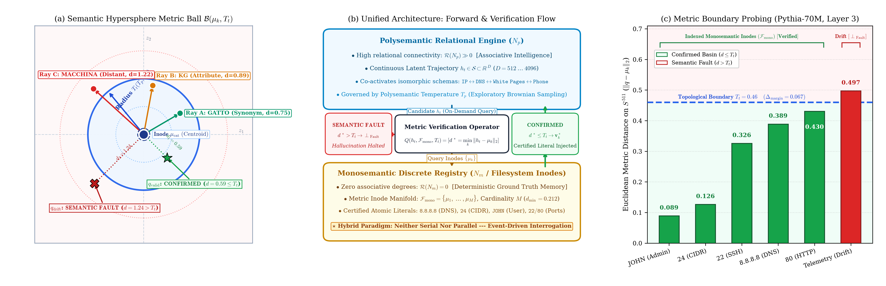

# HySA: Hybrid Semantic Architecture

> **Preserving Polysemantic Abstraction via Contrastive Superposition Tensors, Monosemantic Inodes, and Topological Temperature ($T_t$)**

[](https://doi.org/10.5281/zenodo.23456159)
[](https://opensource.org/licenses/MIT)
[](https://www.python.org/downloads/)
[](https://pytorch.org/)
[](papers/extended/HySA_Extended_EN.pdf)
[](papers/condensed/HySA_Short_EN.pdf)

---

> *"The AI industry views polysemanticity as a curse... yet perhaps it is the very blessing that made intelligence possible."*

Official open-source repository and codebase for the research paper:  
**"HySA: Hybrid Semantic Architecture — Preserving Polysemantic Abstraction via Contrastive Superposition Tensors, Monosemantic Inodes, and Topological Temperature ($T_t$)"**  
*Author:* **Francesco Mariani** (*Independent Systems Architect*, Umbria, Italy — `fratorials@gmail.com`)  
*DOI:* [10.5281/zenodo.23456159](https://doi.org/10.5281/zenodo.23456159)

---

## ⚡ Executive Summary & Paradigm Shift

Contemporary research in **Mechanistic Interpretability** predominantly characterizes neuronal polysemanticity as an undesirable artifact of high-dimensional compression (*the Superposition Hypothesis*), dedicating immense computational resources to decomposing neural representations into dictionaries of purely monosemantic directions using Sparse Autoencoders (SAEs).

**HySA proposes a foundational paradigm shift:**  
**Polysemanticity is not a flaw to be eradicated, but the geometric prerequisite for associative intelligence and analogical reasoning.**

A purely monosemantic neuron possesses zero associative degrees of freedom ($\emptyset$ relational intelligence): devoid of lateral relational pathways, it functions as a rigid, static lookup cell. Conversely, polysemantic units co-activate across isomorphic concepts (e.g., `IP Address`, `DNS`, `White Pages`, `Phone Directory`) to compress disparate instances into higher-order structural schemas. 

| Neuronal Regime | Epistemological Role | Representative Entities | Geometric Property |
| :--- | :--- | :--- | :--- |
| **Polysemantic Network ($N_p$)** | **Intelligence & Analogy** | `IP`, `DNS`, `White Pages`, `Phone Number` | High relational rank $\mathcal{R}(u) \gg 0$; compresses diverse entities into unified structural schemas. |
| **Monosemantic Registry ($N_m$)** | **Memory & Verification** | `8.8.8.8`, `24`, `JOHN`, `Port 53` | Relational rank $\mathcal{R}(u) = 0$; orthogonal atomic anchors guaranteeing $100\%$ factual determinism. |

Rather than coupling $N_p$ and $N_m$ in **series** (which creates a non-abstractive bottleneck that collapses contextual nuance) or in **parallel** (which causes $2\times$ FLOPs overhead and requires heuristic arbitration heads), **HySA integrates both into a Unified Single-Substrate Architecture** operating directly in latent Hilbert space $\mathcal{S} \subset \mathbb{R}^D$.

---

## 🧭 Systems Heuristics vs. Formal Hilbert Geometry

HySA borrows foundational heuristics from operating system (OS) kernel design and formalizes them into rigorous geometric constructs:

| Systems Term | Formal Mathematical Construct in HySA | Architectural Function in HySA |
| :--- | :--- | :--- |
| **Inode ($N_m / \mu_k$)** | Centroid $\mu_k \in S^{D-1} \subset \mathbb{R}^D$ | Orthogonal metric anchor with $\emptyset$ associative degrees, bound to literal $\mathbf{v}_k$. |
| **Filesystem** | Metric Manifold $\mathcal{F}_{\mathrm{mono}} = \{\mu_1, \dots, \mu_M\}$ | Indexed registry ($100\%$ precision) evaluated on-demand during decoding. |
| **Query / API** | Boundary Operator $Q(h, \mathcal{F}_{\mathrm{mono}}, T_t)$ | Deterministic metric condition projecting fluid latent states onto certified literals. |
| **Page Fault** | **Semantic Fault ($\bot_{\mathrm{Fault}}$)** | Explicit exception raised when $d^* > T_t$, halting ungrounded hallucinations. |
| **Temperature** | Metric Neighborhood $\mathcal{B}(\mu_k, T_t)$ | Multidimensional metric volume of tolerance around a concept centroid. |

---

## 🔬 Mathematical Architecture

### 1. Contrastive Superposition Tensors ($I_n$)
A polysemantic unit's multi-concept polytope is extracted as the whole-network inference expectation across contrastive data ($\mathcal{X}^+$ vs. $\mathcal{X}^-$):
$$I_n = \frac{1}{\sum_{X_k \in \mathcal{X}^+} z_{k,n} + \eta} \left[ \sum_{X_k \in \mathcal{X}^+} z_{k,n} \cdot \Phi_{\mathrm{net}}(X_k \mid n) - \gamma \sum_{X_j \in \mathcal{X}^-} z_{j,n} \cdot \Phi_{\mathrm{net}}(X_j \mid n) \right]$$

Algebraic operations are directly supported over feature tensors:
* **Shared Structural Invariant:** $I_{\mathrm{shared}} = I_A \odot I_B$ (Hadamard product)
* **Differential Feature:** $I_{\mathrm{diff}} = \mathrm{ReLU}(I_A - \gamma I_B)$

### 2. The Semantic Hypersphere & Topological Temperature ($T_t$)
Temperature is generalized geometrically as the metric ball $\mathcal{B}(\mu_k, T_t)$ in $\mathcal{S} \subset \mathbb{R}^D$:
$$\mathcal{B}(\mu_k, T_t) = \left\{ x \in \mathcal{S} \;\middle|\; \| x - \mu_k \|_2 \le T_t(T_p, T_m) \right\}$$

Regimes are unified via bounded saturating coupling:
$$T_t(T_p, T_m) = T_m \left( 1 + \alpha \tanh\left( \frac{T_p}{T_m} \right) \right)$$

On the unit sphere $S^{D-1}$, Euclidean distance $\ell_2$ is in exact bijection with spherical angular divergence:
$$\|x - \mu_k\|_2 = \sqrt{2(1 - \cos\theta)}$$

### 3. Metric Boundary Operator ($Q$) & Truncated Voronoi Cells
Given state $h$, nearest centroid $k^* = \arg\min_k \|h - \mu_k\|_2$, and distance $d^* = \|h - \mu_{k^*}\|_2$:
$$Q(h, \mathcal{F}_{\mathrm{mono}}, T_t) = \begin{cases} (\mathrm{CONFIRMED}, \mathbf{v}_{k^*}) & \text{if } d^* \le T_t \\ (\mathrm{FAULT}, \bot) & \text{if } d^* > T_t \end{cases}$$

Decision regions are **Voronoi Cells Truncated by the Metric Ball**:
$$\mathcal{D}_k = \mathrm{Vor}(\mu_k) \cap \mathcal{B}(\mu_k, T_t)$$
guaranteeing a disjoint partition almost everywhere with zero ambiguous overlap.

### 4. Compression Gradient ($\Delta q$), Determinism ($\beta$), and the Critical Point ($P_c$)
The capacity allocation between regimes is defined by:
$$\Delta q = \frac{N_p}{N_m \cdot M}, \quad \beta = \frac{T_t}{q}$$

This forms a strictly convex thermodynamic potential landscape:
$$\mathcal{E}(\Delta q) = \frac{\lambda_{\mathrm{drift}}}{\Delta q} + \lambda_{\mathrm{rigid}} (\Delta q - 1)^2 + \beta_0, \quad \frac{\partial^2 \mathcal{E}}{\partial (\Delta q)^2} > 0$$

The unique global minimum marks the **Critical Point ($P_c$)** balancing fluid creative exploration against deterministic factual verification. In high dimensions, the bounded volume undergoes a sharp **Volume Phase Transition**:
$$\frac{\mathcal{V}_m}{\mathcal{V}_{\mathrm{tot}}} = \frac{(T_t / R)^D}{1 + (T_t / R)^D}$$

---

## 📊 Experimental Results

### Figure 1: Contrastive Superposition Tensors & Algebraic Queries ($32 \times 32$ Manifold)

*Learned polysemantic representations in a 4-neuron bottleneck. Hadamard intersection ($I_1 \odot I_2$) isolates shared circular loops; rectified subtraction ($\mathrm{ReLU}(I_1 - 0.7 I_2)$) isolates differential features without destroying polysemantic connectivity.*

---

### Figure 2: Volume Phase Transition, Critical Point ($P_c$), and Factual Verification

* **(a) Volume Phase Transition:** High-dimensional step-function transition ($D=32$) between $\mathcal{V}_p$ and $\mathcal{V}_m$.
* **(b) Thermodynamic Landscape:** Convex potential $\mathcal{E}(\Delta q)$ identifying the stationary Critical Point $P_c$ under $\beta = T_t/q$.
* **(c) Factual Verification Benchmark:** Unconstrained decoding suffers $>80\%$ literal corruption under rising $T_p$, whereas HySA maintains **$0.0\%$ corruption** on confirmed queries, intercepting drift as explicit Semantic Faults.

---

### Figure 3: Semantic Hypersphere Radial Geometry, Architecture, and Pythia-70M Probing

* **(a) Semantic Hypersphere $\mathcal{B}(\mu_k, T_t)$:** Radial concept vectors (`GATTO`, `KG`, `MACCHINA`) centered on Inode `CAT`. Interrogated trajectories within $T_t$ trigger confirmation; drifting trajectories trigger Semantic Faults.
* **(b) Unified Macro-Architecture:** Fluid $N_p$ reasoning executes on-demand metric verification via operator $Q$ on registry $N_m$.
* **(c) Empirical Residual Stream Distances on Pythia-70M:** Layer 3 probing confirms factual queries fall strictly below $T_t = 0.46$, while unindexed speleological telemetry triggers an explicit fault ($d = 0.497 > T_t$).

---

## 🧪 Empirical Validation on Real Transformer (`EleutherAI/pythia-70m`)

### 1. Isomorphism in the Polysemantic Manifold ($N_p$)
Cosine similarity across four distinct prompts expressing identity-to-address resolution (residual stream Layer 3, $D=512$):

| Conceptual Schema | DNS | IP Routing | White Pages | Phone Directory |
| :--- | :---: | :---: | :---: | :---: |
| **DNS** | $1.000$ | $0.961$ | $0.973$ | $0.893$ |
| **IP Routing** | $0.961$ | $1.000$ | $0.940$ | $0.916$ |
| **White Pages** | $0.973$ | $0.940$ | $1.000$ | $0.903$ |
| **Phone Directory** | $0.893$ | $0.916$ | $0.903$ | $1.000$ |

*High cosine similarity ($\ge 0.893$) proves empirically that deep transformers naturally construct polysemantic manifolds representing abstract relational schemas across distant domains.*

### 2. Empirical Factual Verification Benchmark ($T_t = 0.46$)

| Target Concept | Interrogated Prompt | Raw $N_p$ Output | Distance $d^*$ | HySA Status ($T_t=0.46$) | Certified Output |
| :--- | :--- | :--- | :---: | :---: | :--- |
| `SSH_PORT` | *"...SSH default port is"* | `' 1'` (**Hallucination**) | $0.3257$ | **CONFIRMED** ($d^* \le T_t$) | `' 22'` (Exact) |
| `HTTP_PORT` | *"...HTTP default port is"* | `' used'` (**Hallucination**) | $0.4304$ | **CONFIRMED** ($d^* \le T_t$) | `' 80'` (Exact) |
| `PUBLIC_DNS_IP` | *"...Google public DNS resolver is"* | `' used'` (**Hallucination**) | $0.3889$ | **CONFIRMED** ($d^* \le T_t$) | `' 8.8.8.8'` (Exact) |
| `SUBNET_MASK` | *"...255.255.255.0 has CIDR length"* | `' 0'` (**Hallucination**) | $0.1263$ | **CONFIRMED** ($d^* \le T_t$) | `' 24'` (Exact) |
| `ADMIN_NAME` | *"...root user first name literal is"* | `' the'` (**Hallucination**) | $0.0889$ | **CONFIRMED** ($d^* \le T_t$) | `' JOHN'` (Exact) |
| `UNINDEXED` | *"...subterranean speleological sensors..."* | `' a'` (**Nonsense**) | $0.4973$ | **SEMANTIC FAULT** ($d^* > T_t$) | **[HALTED]** |

---

## 📁 Repository Structure & Artifacts

```
HySA Paper/
├── README.md                              # Comprehensive documentation and reproduction guide
│
├── hysapaper_extended_singlecolumn.pdf    # Flagship English 12-page extended edition (Single-column)
├── hysapaper_extended_singlecolumn.tex    # LaTeX source for flagship English edition
│
├── hysapaper_extended_ita.pdf             # Flagship Italian 12-page extended edition (Single-column)
├── hysapaper_extended_ita.tex             # LaTeX source for flagship Italian edition
│
├── hysapaper_extended.pdf                 # Conference 8-page two-column edition (NeurIPS/ICLR style)
├── hysapaper_extended.tex                 # LaTeX source for conference edition
│
├── fig1_imprinted_tensors.png / .pdf      # Figure 1: Imprinted tensors and Hadamard algebra
├── fig2_phase_transition.png / .pdf       # Figure 2: Phase transition, potential landscape, benchmark
├── fig3_hypersphere_geometry.png / .pdf   # Figure 3: Semantic Hypersphere, architecture, Pythia probing
│
├── run_experiment.py                      # Synthetic 32x32 manifold training and benchmark
├── generate_fig3.py                       # High-res generation script for Figure 3
└── hysa_pythia.py                         # Pythia-70M residual stream probing and Inode verification
```

---

## 🚀 Quickstart & Reproduction

### 1. Setup Environment
```bash
# Clone the repository
git clone https://github.com/fratorials/HySA.git
cd HySA

# Create and activate Python virtual environment
python3 -m venv venv
source venv/bin/activate

# Install dependencies
pip install --upgrade pip
pip install -r requirements.txt
```

### 2. Run Experiments & Generate Figures
```bash
# Run the synthetic 32x32 benchmark (generates Figure 1 & Figure 2 in papers/figures/)
python3 src/run_synthetic_benchmark.py

# Run real-world transformer probing on Pythia-70M
python3 src/run_pythia_validation.py

# Generate high-resolution Figure 3
python3 src/generate_figures.py
```

### 3. Compile LaTeX Manuscripts
```bash
# Compile Flagship 12-page Extended English edition (single-column)
cd papers/extended
pdflatex -interaction=nonstopmode HySA_Extended_EN.tex
pdflatex -interaction=nonstopmode HySA_Extended_EN.tex

# Compile Flagship 12-page Extended Italian edition (single-column)
pdflatex -interaction=nonstopmode HySA_Extended_IT.tex
pdflatex -interaction=nonstopmode HySA_Extended_IT.tex

# Compile 4-page Condensed English Conference Short-Paper (two-column)
cd ../condensed
pdflatex -interaction=nonstopmode HySA_Short_EN.tex
pdflatex -interaction=nonstopmode HySA_Short_EN.tex

# Compile 4-page Condensed Italian Conference Short-Paper (two-column)
pdflatex -interaction=nonstopmode HySA_Short_IT.tex
pdflatex -interaction=nonstopmode HySA_Short_IT.tex
```

---

## 📁 Repository Structure

```text
HySA/
├── README.md                      # Overview, paradigm shift, BibTeX citation
├── LICENSE                        # MIT License
├── requirements.txt               # Reproducible dependencies
├── .gitignore                     # Ignores LaTeX builds, venv, and large archives
│
├── papers/                        # 📄 Official Manuscripts & Vector Figures
│   ├── figures/                   # Shared vector PDF figures (Fig 1, 2, 3)
│   ├── extended/                  # 12-page Flagship Journal Editions
│   │   ├── HySA_Extended_EN.pdf   # English Flagship
│   │   ├── HySA_Extended_IT.pdf   # Italian Flagship
│   │   └── HySA_Extended_TwoColumn_EN.pdf # 8-page 2-Column Reference
│   └── condensed/                 # 4-page Conference Short-Papers
│       ├── HySA_Short_EN.pdf      # English Short Paper (NeurIPS/ICLR style)
│       └── HySA_Short_IT.pdf      # Italian Short Paper
│
├── src/                           # 🧠 Python Source Code
│   ├── run_synthetic_benchmark.py # Synthetic 32x32 manifold bottleneck experiment
│   ├── run_pythia_validation.py   # EleutherAI/pythia-70m residual stream probing
│   └── generate_figures.py        # High-resolution vector plot generator
│
├── assets/                        # 🖼️ High-resolution PNGs for README / Web
│   ├── fig1_imprinted_tensors.png
│   ├── fig2_phase_transition.png
│   └── fig3_hypersphere_geometry.png
│
└── drafts/                        # 📝 Historical notes and text drafts
```

---

## 📜 Citation

If you find HySA relevant to your research in mechanistic interpretability, neurosymbolic architectures, or hallucination mitigation, please cite:

```bibtex
@article{mariani2026hysa,
  title={{HySA: Hybrid Semantic Architecture — Preserving Polysemantic Abstraction via Contrastive Superposition Tensors, Monosemantic Inodes, and Topological Temperature ($T_t$)}},
  author={Mariani, Francesco},
  journal={arXiv preprint / Zenodo},
  year={2026},
  month={October},
  doi={10.5281/zenodo.23456159},
  url={https://doi.org/10.5281/zenodo.23456159}
}
```

---

## 📄 License
This project is licensed under the [MIT License](LICENSE).