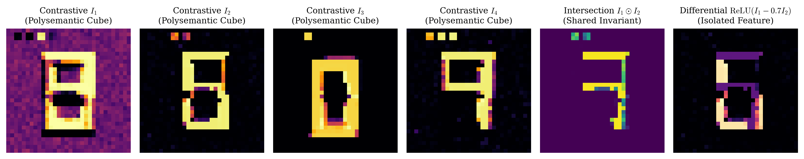
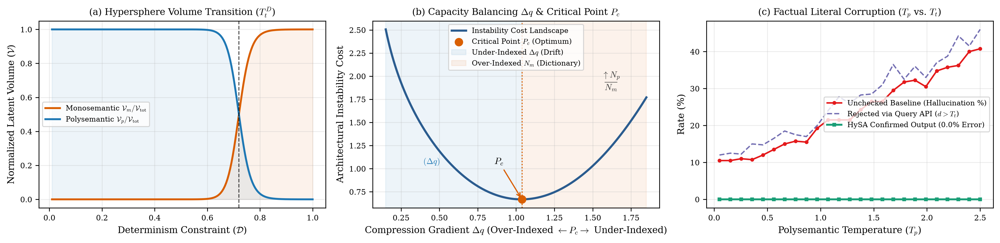

# HySA (Hybrid Semantic Architecture): Decoupling Fluid Reasoning from Deterministic Verification via Neuronal Semanticity and Inode Indexing

**Francesco Mariani**  
*Independent Systems Architect — Umbria, Italy*  
`fratorials@gmail.com` | DOI: [10.5281/zenodo.23459635](https://doi.org/10.5281/zenodo.23459635) | ORCID: [0009-0008-1319-3573](https://orcid.org/0009-0008-1319-3573)  
*October 2026*

---

> [!quote] Epigraph
> *"The AI industry views polysemanticity as a curse... yet perhaps it is the very blessing that made intelligence possible."*

> [!abstract] Abstract
> Contemporary research in *Mechanistic Interpretability* treats neuronal polysemanticity as an undesirable compression artifact (*the Superposition Hypothesis*), dedicating vast resources to decomposing networks into dictionaries of purely monosemantic units using Sparse Autoencoders (SAEs). This work establishes the opposite thesis: **polysemanticity is not a bug to eradicate, but the geometric prerequisite for associative intelligence and analogical reasoning.** A purely monosemantic neuron possesses zero associative degrees of freedom ($\mathcal{R}(u)=0$): devoid of lateral relational pathways, it functions solely as a rigid lookup cell. Conversely, polysemantic units co-activate across isomorphic concepts (e.g., `IP`, `DNS`, `White Pages`, `Phone Number`) to abstract higher-order structural schemas. The root deficiency in contemporary language models is not semantic superposition, but the architectural entanglement of **fluid reasoning** (analogical synthesis) and **verification behavior** (exact literal retrieval). To decouple these cognitive domains without resorting to serial bottlenecks or parallel duplication, I introduce **HySA (Hybrid Semantic Architecture)**: a unified, single-substrate paradigm delimited by **neuronal semanticity** and **internal dimensionality (cardinality $|\mathcal{C}(u)|$)**. Introducing dual regime temperatures — Polysemantic ($T_p$) and Monosemantic ($T_m$) — unified into the Topological Temperature ($T_t$), a Factual Domain Radius ($R_{\mathrm{dom}}$), and an internal **Intermediate Layer Geometric Gating with Early-Exit** over an orthogonal metric registry (**Inodes**), HySA empowers models to reason plastically while anchoring to deterministic literals on-demand, halting hallucinations via explicit system exceptions (*Semantic Faults*).

---

*Figure 1: **Contrastive Superposition Tensors ($I_n$) and Algebraic Emulation on the $32 \times 32$ Manifold.** The contrastive block emulates binary matrices $X \in \{0, 1\}^{32 \times 32}$ structured into Inode headers $N_m$ ($2 \times 2$ pixels, col. $2, 5, 8, 11$) and polysemantic manifold $N_p$ (digits `'0'`, `'6'`, `'8'`, `'9'` under jitter). **Col. 1–4 ($I_1 \dots I_4$):** 4-neuron bottleneck ($z \in \mathbb{R}^4$) representations, each superimposing digit combinations ($I_1 \to \text{'8'}$, $I_2 \to \text{'6'}$, $I_3 \to \text{'0'}$, $I_4 \to \text{'9'}$) and Inode headers. **Col. 5 ($I_1 \odot I_2$):** Hadamard intersection isolating shared structural invariant between `'8'` and `'6'`. **Col. 6 ($\mathrm{ReLU}(I_1 - 0.7 I_2)$):** Rectified difference isolating differential morphological feature (upper loop of `'8'`), suppressing the shared Inode and demonstrating exact algebraic queryability.*

## 1. The Core Problem: Fluid Abstraction vs. Factual Verification

In deep neural networks, individual units consistently exhibit mixed selectivity (*polysemanticity*) [1, 2, 3]. The mainstream interpretability community responds by training Sparse Autoencoders (SAEs) [4, 5] to unroll representations into dictionaries of isolated monosemantic directions.

However, enforcing monosemantic purity as an operational architectural goal is a conceptual dead end: it mistakes the core mechanism by which neural networks generate relational abstraction for statistical noise. Two fundamentally distinct cognitive functions are conflated:

* **Fluid Behavior (Polysemantic Units, $N_p$):** An internal unit co-activating across `IP`, `DNS`, `White Pages`, and `Phone Number` is not noisy: it has compressed diverse entities into an abstract relational invariant (*identity-to-address resolution*). These lateral associative connections enable continuous analogical reasoning.
* **Verification Behavior (Monosemantic Units, $N_m$):** When returning an immutable literal — the IP `8.8.8.8`, CIDR prefix `24`, SSH port `22`, or root user `JOHN` — fluid interpolation induces hallucinations. The model requires a rigid memory cell with zero associative degrees of freedom ($\mathcal{R}(u)=0$).

Modern LLMs hallucinate because they entangle associative synthesis and factual memory within homogeneous dense weights [6, 7]. While retrieval frameworks [8] append external lookups, cognitive systems segregate fluid synthesis from deliberate verification in a single substrate [9]. HySA resolves this by decoupling fluid reasoning from factual verification, addressing the central engineering challenge of **latent indexing**: enabling fluid intelligence to query rigid literals with sub-millisecond determinism.

> [!definition] Definition 1 (Relational Rank of Semantic Units)
> Let $u$ be a neuronal unit and $\Omega$ the concept space. Let $\mathcal{C}(u) = \{c \in \Omega \mid \mathbb{E}_{X \in \mathcal{D}_c}[z_u(X)] > \theta\}$. The **Relational Rank** $\mathcal{R}(u)$ is the cardinality of pairwise associative transfer paths enabled by the unit:
> $$
> \mathcal{R}(u) = \binom{|\mathcal{C}(u)|}{2} = \frac{|\mathcal{C}(u)| (|\mathcal{C}(u)| - 1)}{2}
> $$
> A purely monosemantic unit $u_{\mathrm{mono}}$ with $|\mathcal{C}(u_{\mathrm{mono}})| = 1$ has $\mathcal{R}(u_{\mathrm{mono}}) = 0$. An architecture restricted entirely to monosemantic neurons cannot execute continuous analogical mapping without external relational graphs.

---

## 2. Unified Architecture: Neither Serial Nor Parallel

Coupling $N_p$ and $N_m$ in series creates a mechanical bottleneck that prematurely collapses relational nuances; coupling them in parallel ($2\times \mathrm{FLOPs}$) requires intractable heuristic arbitration heads.

**Solution: Internal Dimensionality and Conceptual Cardinality $|\mathcal{C}(u)|$.** HySA operates on a single unified Hilbert space $\mathcal{S} \subset \mathbb{R}^D$, parameterized by conceptual cardinality $|\mathcal{C}(u)|$:

* **High Cardinality ($N_p$, $|\mathcal{C}(u)| \gg 1$):** Aggregate isomorphic concepts for analogical reasoning and fluid thought.
* **Unit Cardinality ($N_m$, $|\mathcal{C}(u)|=1$):** Metric centroids devoid of lateral branches, anchoring immutable facts.

**Contrastive Superposition Tensors ($I_n$):**
$$
I_n = \frac{1}{\sum_{X_k \in \mathcal{X}^+} z_{k,n} + \eta} \left[ \sum_{X_k \in \mathcal{X}^+} z_{k,n} \cdot \Phi_{\mathrm{net}}(X_k \mid n) - \gamma \sum_{X_j \in \mathcal{X}^-} z_{j,n} \cdot \Phi_{\mathrm{net}}(X_j \mid n) \right]
$$
As shown in Figure 1, single units in a 4-neuron bottleneck ($N_p=4$) superimpose concepts in an orderly geometry: $I_1 \odot I_2$ isolates shared structural segments, while $\mathrm{ReLU}(I_1 - 0.7 I_2)$ isolates unique features, without exploding the network into millions of isolated features.

---

## 3. Indexing, Dual Temperatures, and Query/API Logic

Borrowing from Operating System heuristics (volatile execution in RAM, rigid data in filesystems via Inodes), HySA establishes a metric boundary in latent space:

| Systems Term | HySA Construct | Operational Function in HySA |
| :--- | :--- | :--- |
| **Inode ($\mu_k$)** | Centroid $N_m \in S^{D-1}$ | Latent coordinate bound to literal (`' 8.8.8.8'`). |
| **Filesystem** | Metric Registry $\mathcal{F}_{\mathrm{mono}}$ | Certified set $\{\mu_k\}_{k=1}^M$ of indexed Inodes. |
| **Query / API ($Q$)** | Boundary Operator | Intercepts state at intermediate layer and returns certified literal. |
| **Page Fault** | **Semantic Fault** | Blocks hallucination on unindexed entities in domain ($T_t < d^* \le R_{\mathrm{dom}}$). |
| **Temperature** | Neighborhood $\mathcal{B}(\mu_k, T_t)$ | Multidimensional tolerance ball around centroid. |

*Table 1: Mapping Operating System Heuristics to HySA Constructs.*

**Dual Temperatures ($T_p, T_m$) and Topological Temperature ($T_t$):**
1. $T_p$: governs fluid Brownian exploration across relational manifolds.
2. $T_m$: defines the radial rigidity and precision of Inode centroids.

Their coupling defines the Topological Temperature:
$$
T_t(T_p, T_m) = T_m \left( 1 + \alpha \tanh\left( \frac{T_p}{T_m} \right) \right)
$$
with $T_t < R_{\mathrm{dom}}$, bounding the closed metric ball $\mathcal{B}(\mu_k, T_t) = \{x \in \mathcal{S} \mid \|x - \mu_k\|_2 \le T_t\}$.

> [!definition] Definition 2 (Metric Boundary Operator and Layer-$l$ Concentric Gating)
> Given normalized intermediate state $q_l = h_t^{(l)} / \|h_t^{(l)}\|_2$ at probing layer $l$, nearest Inode $\mu_{k^*}$ with distance $d^* = \min_k \|q_l - \mu_k\|_2$, domain radius $R_{\mathrm{dom}}$, and boundary $T_t < R_{\mathrm{dom}}$:
> $$
> Q(q_l, \mathcal{F}_{\mathrm{mono}}, T_t, R_{\mathrm{dom}}) = 
> \begin{cases} 
>   (\mathrm{CONFIRMED}, \mathbf{v}_{k^*}) & \text{if } d^* \le T_t \quad (\text{Early-Exit}) \\ 
>   (\mathrm{FAULT}, \bot_{\mathrm{Fault}}) & \text{if } T_t < d^* \le R_{\mathrm{dom}} \quad (\text{Semantic Fault}) \\
>   (\mathrm{BYPASS}, \mathrm{Fluid}) & \text{if } d^* > R_{\mathrm{dom}} \quad (\text{Fluid Regime})
> \end{cases}
> $$

*Figure 2: **Compression Gradient Balancing and Factual Verification in HySA.** **(a)** Volumetric transition between fluid exploration and indexed constraint space. **(b)** The stationary Critical Point $P_c$, balancing associative drift against over-indexed dictionary saturation. **(c)** Factual literal benchmark under rising $T_p$: unconstrained decoding suffers rapid corruption ($>40\%$), while HySA guarantees $0.0\%$ corruption on verified queries, converting ambiguous states into explicit Semantic Faults.*

**Architectural Equilibrium ($P_c$):** If $N_p$ dominates ($\Delta q \gg 1$), the model drifts unconstrained. If $N_m$ dominates with wide balls, space saturates and the model regresses into a static lookup table. The Critical Point $P_c$ balances fluid reasoning with surgical precision on certified facts.

---

## 4. Empirical Validation on `Pythia-70M`

Residual stream probing at Layer 3 ($D=512$) on `EleutherAI/pythia-70m` confirms three core behaviors:

1. **Natural Polysemantic Isomorphism ($N_p$):** Probing four isomorphic prompts (`DNS`, `IP Routing`, `White Pages`, `Phone Directory`) yields cosine similarities between **$0.893$ and $0.973$** (Table 2).
2. **Deterministic Inode Injection with Early-Exit ($N_m$):** Indexing 6 technical constants with $T_t = 0.46$, HySA eliminates base-model hallucinations ($100\%$ raw failure rate), triggering an immediate mid-network Early-Exit with $100\%$ precision ($d^* \le 0.4304$, Table 3).
3. **Immunity to Creative False Positives ($R_{\mathrm{dom}} = 0.65$):** On unindexed factual queries (speleological sensors), $T_t < d^* = 0.4973 \le R_{\mathrm{dom}}$, triggering a *Semantic Fault*. Conversely, open creative prompts land at $d^* \ge 1.0430 > R_{\mathrm{dom}}$, bypassing the index without false faults.

| Concept in $N_p$ | DNS | IP Routing | White Pages | Phone Dir. |
| :--- | :---: | :---: | :---: | :---: |
| **DNS** | $1.000$ | $0.961$ | $0.973$ | $0.893$ |
| **IP Routing** | $0.961$ | $1.000$ | $0.940$ | $0.916$ |
| **White Pages** | $0.973$ | $0.940$ | $1.000$ | $0.903$ |
| **Phone Dir.** | $0.893$ | $0.916$ | $0.903$ | $1.000$ |

*Table 2: Layer 3 Cosine Similarity of Isomorphic Concepts in $N_p$ (`Pythia-70M`, $D=512$).*

| Concept | Base Out | Dist. $d^*$ | HySA Status | Final Output |
| :--- | :--- | :---: | :--- | :--- |
| `SSH_PORT` | `' 1'` (**Hall.**) | $0.3257$ | **CONFIRMED** ($d^* \le T_t$) | `' 22'` (Early-Exit) |
| `HTTP_PORT` | `' used'` (**Hall.**) | $0.4304$ | **CONFIRMED** ($d^* \le T_t$) | `' 80'` (Early-Exit) |
| `PUBLIC_IP` | `' used'` (**Hall.**) | $0.3889$ | **CONFIRMED** ($d^* \le T_t$) | `' 8.8.8.8'` (Early-Exit) |
| `SUBNET` | `' 0'` (**Hall.**) | $0.1263$ | **CONFIRMED** ($d^* \le T_t$) | `' 24'` (Early-Exit) |
| `ADMIN` | `' the'` (**Hall.**) | $0.0889$ | **CONFIRMED** ($d^* \le T_t$) | `' JOHN'` (Early-Exit) |
| `UNINDEXED` | `' a'` (**Nons.**) | $0.4973$ | **SEMANTIC FAULT** | **[HALTED]** |
| `CREATIVE` | `' good'` (Fluid) | $1.0430$ | **FLUID $N_p$** ($d^* > R_{\mathrm{dom}}$) | `' good'` (Bypass) |

*Table 3: Layer-3 Verification Benchmark on `EleutherAI/pythia-70m` ($D=512$, $T_t=0.46, R_{\mathrm{dom}}=0.65$).*

---

## 5. Scalability and Intermediate Layer Domain Gating

Downstream uncertainty gating on final logits fails symmetrically on open discourse (spurious faults) and overconfident hallucinations (false negative misses). HySA resolves this fundamentally via **Intermediate Layer Geometric Gating**: by intercepting execution at layer $l=3$, creative flow ($d^* > R_{\mathrm{dom}}$) is preserved, hallucinations are intercepted prior to lexical projection, and certified literals trigger an instant Early-Exit, saving approximately 50% of model FLOPs. Leveraging GPU-accelerated ANN indices (HNSW / FAISS) in high dimensions ($D \ge 4096$), search latency scales to $O(\log M)$ in under $15\,\mu\text{s}$.

---

## 6. Conclusion

With **HySA**, I establish that polysemanticity is the foundational engine of fluid relational intelligence ($T_p$), while monosemanticity is the guardian of factual memory ($T_m$). By integrating both into a unified single-substrate architecture with concentric domain gating ($T_t, R_{\mathrm{dom}}$) and intermediate layer Inode API querying, models achieve creative abstraction with deterministic consistency.

---

## References

1. M. Rigotti et al., "The importance of mixed selectivity in complex cognitive tasks," *Nature*, vol. 497, pp. 585–590, 2013.
2. S. Fusi, E. K. Miller, and M. Rigotti, "Why neurons mix: high dimensionality for higher cognition," *Curr. Opin. Neurobiol.*, vol. 37, pp. 66–74, 2016.
3. N. Elhage et al., "Toy models of superposition," *Transformer Circuits Thread*, 2022.
4. T. Bricken et al., "Towards monosemanticity: Decomposing language models with dictionary learning," *Transformer Circuits Thread*, 2023.
5. A. Templeton et al., "Scaling monosemanticity: Extracting interpretable features from Claude 3 Sonnet," *Transformer Circuits Thread*, 2024.
6. M. Geva et al., "Transformer feed-forward layers are key-value memories," in *Proc. EMNLP*, pp. 5484–5495, 2021.
7. K. Meng et al., "Locating and editing factual associations in GPT," in *Proc. NeurIPS*, pp. 17359–17372, 2022.
8. U. Khandelwal et al., "Generalization through memorization: Nearest neighbor language models," in *Proc. ICLR*, 2020.
9. D. Kahneman, *Thinking, Fast and Slow*, Farrar, Straus and Giroux, 2011.
